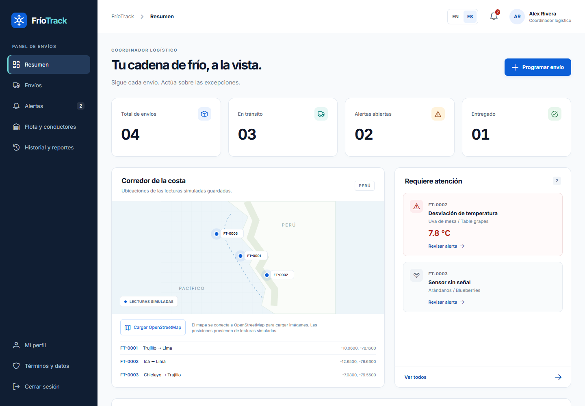
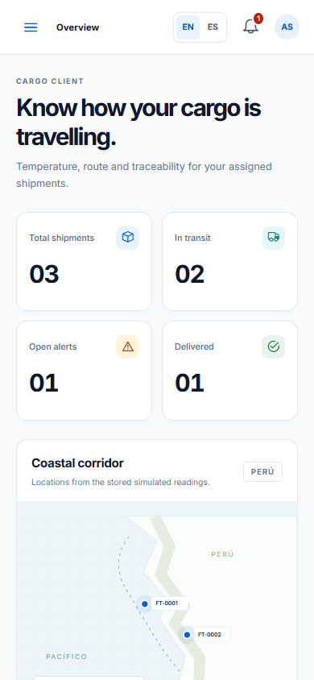
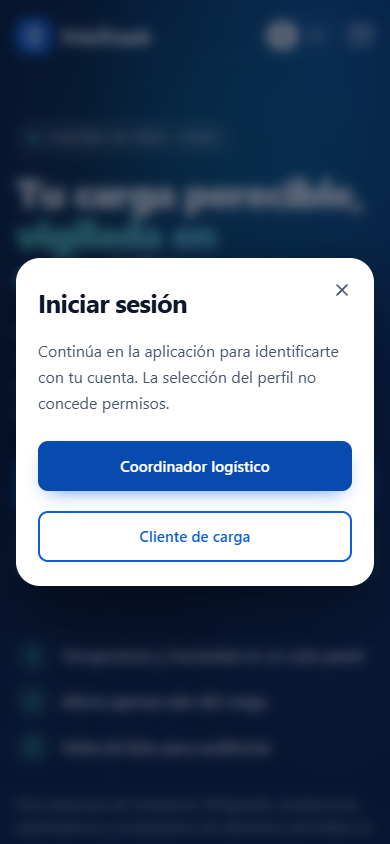

# Evidencias de revisión TB1

Corte histórico: 11/11/2026, America/Lima. Los resultados corresponden a los entornos y versiones indicados en sus recibos.

## Verificaciones registradas

- Frontend: 18 pruebas automáticas y build de producción con 228 módulos.
- API independiente: publicación .NET 10 y 26 comprobaciones locales con almacén temporal.
- Integración local: [157 comprobaciones](../evidence/local-integrated-acceptance.json), ambos perfiles, ES/EN y 390/1440 px; acceso, permisos, rutas, sesión, menú móvil, diseño responsive y CTA de landing.
- Consulta pública del 11/11: [recibo](../evidence/public-predeployment-2026-11-11.json). Los tres servicios respondieron 200; las páginas consultadas correspondían a la publicación anterior de ese corte.

Las imágenes proceden del navegador de pruebas del entorno local. Su alcance se limita a los casos incluidos en los recibos.

## Tareas y aceptación

El [catálogo de 58 tareas](tablero-preparado/README.md) conserva IDs, historias, descripciones y estimaciones de revisión. Los estados del catálogo derivan del informe, no de un export de Trello. Los [criterios de aceptación](tablero-preparado/CHECKLIST-ACEPTACION.md) y el [formato de revisión](tablero-preparado/registro-aceptacion-58.csv) relacionan decisiones con evidencia.

## Publicación AV2

La actualización del 14/11/2026 está acreditada en los recibos de [API](../evidence/av2/redeployment-api.json), [SPA](../evidence/av2/redeployment-frontend.json) y [landing](../evidence/av2/redeployment-landing.json), y en los [recorridos del entorno público](../evidence/av2/public-interview-verification.json). Se conservaron los datos anteriores y se separaron los datos de demostración.

## Persistencia

El servicio histórico TB1 utilizaba un almacén JSON privado. El incremento AV2 utiliza PostgreSQL 17, EF Core y migraciones, con transacciones de reservas, aislamiento por organización y documentación OpenAPI. La telemetría física está fuera del alcance de esta versión.
