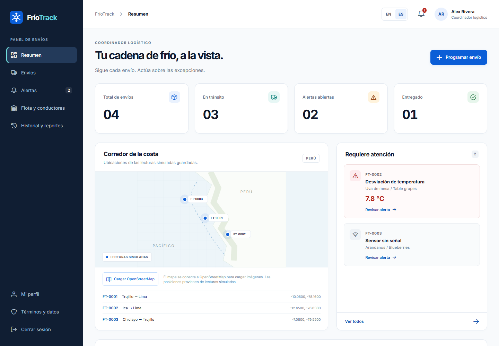
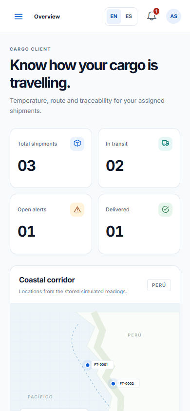
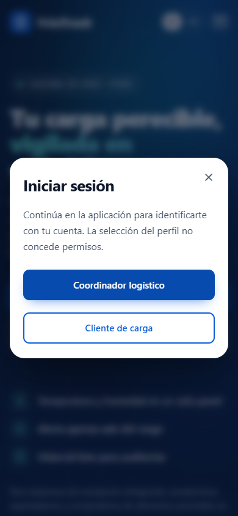

# Cierre de evidencias TB1

Revisión del 11/11/2026, America/Lima. Esta guía separa trabajo preparado, pruebas ejecutadas y evidencias del equipo pendientes. No certifica reuniones ni aceptaciones que no se hayan registrado.

## Qué se verificó

- Frontend: 18 pruebas automáticas y build de producción con 228 módulos.
- API independiente: publicación .NET 10 y 26 comprobaciones locales con almacén temporal y contraseñas desechables.
- Integración local: [157 comprobaciones](../evidence/local-integrated-acceptance.json), ambos perfiles, ES/EN y 390/1440 px; acceso, permisos, rutas, sesión, menú móvil, ausencia de desbordamiento de página y CTA de landing. Las peticiones del bundle se dirigieron a la API local real; no se simularon sus respuestas.
- Consulta pública previa: [recibo](../evidence/public-predeployment-2026-11-11.json). Los tres servicios respondieron 200. Los HTML de landing y frontend todavía no corresponden al build corregido al momento de esa consulta.

Las imágenes son renders del navegador de pruebas sin ventana, no capturas del escritorio personal ni de Azure. No prueban todos los estados de cada historia, WCAG completo, mapas externos o sensores físicos.

## 1. Tablero actualizado

Conectar Trello con una cuenta que pueda editar [el tablero](https://trello.com/b/6qrvOukt/blackstartup-fr%C3%ADotrack). La sesión GitHub no concede acceso a Trello. La [preparación de las 58 tareas](tablero-preparado/README.md) contiene IDs, historias, descripciones, horas de revisión, enlaces y listas propuestas; no es un export del tablero real ni prueba que se haya actualizado.

Antes de modificar, guardar el export JSON actual, leer las tarjetas y actualizar por Task ID para evitar duplicados. Conservar tarjetas y actividad histórica. Usar To Do, In Process, To Review y Done; identificar Sprint 1 y Sprint 2 mediante etiquetas. Mantener la atribución histórica separada del responsable actual confirmado. Un integrante retirado no recibe asignaciones nuevas.

Después de editar, conservar URLs de tarjetas, fecha de corte, export JSON y una captura real tomada por el equipo. Estas evidencias deben corresponder al mismo estado que las tablas y CSV del reporte.

## 2. Revisión y colaboración entre productos

Cada integrante debe demostrar y revisar trabajo real del producto que le corresponda. Enlazar landing → SPA → API con sus tarjetas, commits y versiones. El número de commits ayuda a rastrear actividad, pero no reemplaza revisión, integración o aceptación.

Aplicar el [checklist de aceptación](tablero-preparado/CHECKLIST-ACEPTACION.md) y completar el [registro vacío de revisión](tablero-preparado/registro-aceptacion-58.csv) solo con resultados reales: versión, escenario, esperado, observado, evidencia, revisor y fecha. Mover a Done después de aceptación. Una revisión técnica automática puede dejar una tarea To Review.

Guardar un acta de la reunión que efectivamente se realice, con fecha, asistentes, demostraciones, decisiones y pendientes. No reconstruir reuniones pasadas. La carátula, la exposición y la evaluación individual son artefactos distintos de estos recibos técnicos.

## 3. Publicar las fuentes corregidas

La [herramienta de actualización de recursos existentes](https://github.com/upc-pre-202620-1asi0730-8088-FrioTrackk/friotrack-frontend/blob/main/docs/redeployment.md) permite publicar API, SPA y landing con una autenticación Microsoft. Valida SHA y origen Git, rechaza secretos en los artefactos, conserva datos y configuración y verifica los archivos públicos por SHA-256.

Para ejecutar la publicación se necesita la cuenta Azure que tenga permiso sobre Storage y App Service. El inicio de sesión lo realiza el titular mediante el flujo oficial de Microsoft; no requiere Computer Use, contraseñas en el chat ni acceso a la pantalla.

Después de publicar, adjuntar los recibos con SHA de fuente, archivos o ZIP, fecha, resultado e ID real de Kudu para API. Repetir los recorridos autenticados sobre las URLs públicas con las credenciales existentes suministradas por un canal privado. Las pruebas locales y un health 200 no certifican esos recorridos publicados.

## Base de datos y coordinación con el equipo

No hace falta crear otra base de datos para corregir el tablero o actualizar esta entrega TB1: la API actual persiste en un archivo JSON privado de una sola instancia. No se propone contratar servicios adicionales para este cierre.

Para la evolución del backend, el equipo sí debe planificar ASP.NET Core con EF Core, PostgreSQL o MySQL, migraciones, transacciones de reservas, aislamiento por organización y OpenAPI, de acuerdo con la entrega correspondiente. Crear una base de datos vacía no implementa el modelo DDD ni acredita sensores físicos.

Mientras un paso requiera acceso o revisión humana pendiente, se conserva expresamente como pendiente; esta guía no convierte los materiales preparados en evidencia terminada.
