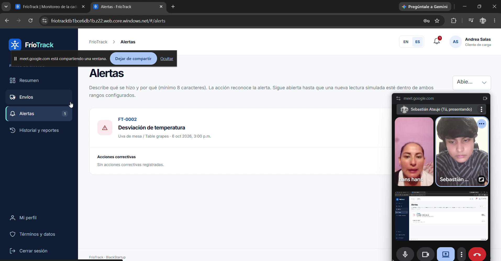

# 5.3.3. Evaluaciones según heurísticas

La evaluación aplica la estructura del Anexo D del curso: identificación, alcance, severidad, resumen y fichas de hallazgos. Se revisaron las entrevistas AV2 y sus capturas. La severidad es un juicio de revisión documental del 15/11/2026, no una medición de frecuencia ni una nueva prueba con participantes.

## Datos de la evaluación

| Campo | Registro |
| --- | --- |
| Carrera | Ingeniería de Software. |
| Curso | 1ASI0730 - Aplicaciones Web. |
| Sección | NRC 8088. |
| Profesor | Bautista Ubillús, Efraín Ricardo. |
| Auditor documental | Rodrigo Andree Saavedra Flores, equipo BlackStartup. |
| Cliente del proyecto | BlackStartup; segmentos: empresas de transporte refrigerado y clientes de carga. |
| Sitio o aplicación | FríoTrack: landing y aplicación web. |
| Versión de referencia | AV2, Sprint 3. Corte técnico: API `e9aca8e`, frontend `9ef083e` y landing `36f2067`; publicación del 14/11/2026. Las grabaciones no identifican el SHA mostrado. |
| Entorno documentado | Landing en GitHub Pages y aplicación en Azure; cuentas y telemetría de demostración. |
| Fecha de evaluación | 15/11/2026; entrevistas del 14 y 15/11/2026. |
| Método | Análisis de fichas, capturas y registros técnicos, con clasificación según las heurísticas de Nielsen. |
| Fuentes | [Entrevistas](../../README.md#532-registro-de-entrevistas), [registro de sesiones](validation-records.csv) y [comprobaciones públicas](../../assets/evidence/av2/public-interview-verification.json). |

## Tareas incluidas y excluidas

| Sesión | Tarea incluida | Alcance observado | Exclusión y motivo |
| --- | --- | --- | --- |
| AV2-C01 - Farit Santoyo | Interpretar propuesta, envíos, lecturas, alertas e historial. | Demostración guiada con cuenta Cliente de Carga y respuestas de comprensión. | Programación y atención como coordinador: la cuenta mostrada corresponde al cliente. |
| AV2-C02 - Carol Solsol | Revisar monitoreo, rangos, alertas e historial. | Demostración guiada con perfil coordinador, según la ficha aportada por Nayely Vera. | Eficacia autónoma y tiempos: la ficha no describe una prueba independiente de tareas. |
| AV2-L01 - Irma Barreto | Comprender estados, alertas e historial; valorar el reporte. | Demostración guiada con perfil cliente y comentarios sobre JSON y legibilidad. | Tasa de éxito y descarga autónoma: no se midieron en la sesión descrita. |
| AV2-L02 - Gustavo Honorio | Comprender la propuesta y el significado de las alertas. | Reacción verbal después de ver la landing. | Interacción con la aplicación: no hubo sesión autenticada ni tareas navegadas. |
| AV2-L03 - Jari Hassan Syeda | Relacionar la demostración con la recepción de productos y comentar los controles. | Montaje de entrevista y recorrido narrado con cuenta coordinador. | Validación autónoma del cliente: el recorrido está incorporado en la edición y las respuestas se centran en inventario. |

La captura de AV2-L01 permite evaluar el texto visible de la pantalla de alertas. Las opiniones se tratan como evidencia cualitativa; no permiten inferir fallos de seguridad, persistencia ni tasas de usabilidad. Sensores físicos, pagos y correo externo quedan fuera del alcance.

## Escala de severidad

| Nivel | Significado |
| :---: | --- |
| 1 | Superficial: efecto reducido y baja urgencia. |
| 2 | Menor: dificulta la comprensión o añade esfuerzo, aunque la consulta puede continuar. |
| 3 | Mayor: puede desviar la interpretación de una función central; prioridad alta. |
| 4 | Muy grave: impide una tarea esencial y requiere corrección antes de liberar la función. |

Se identifican tres hallazgos: uno de severidad 3 y dos de severidad 2. Las fuentes examinadas no documentan un bloqueo crítico que justifique severidad 4.

## Resumen de hallazgos

| ID | Problema | Severidad | Heurística | Fuente y tarea |
| --- | --- | :---: | --- | --- |
| H-01 | El JSON resulta técnico para leer y compartir un resumen del envío. | 2 | H2: correspondencia con el mundo real; H8: información esencial. | AV2-L01, historial y reporte; AV2-C01 y AV2-C02 refuerzan la necesidad de un resumen. |
| H-02 | Las alertas térmicas se confunden con avisos de vencimiento de inventario. | 3 | H2: correspondencia con el mundo real; H10: ayuda contextual. | AV2-L02, comprensión de la landing; AV2-L03, comentarios sobre inventario. |
| H-03 | La pantalla de alertas pide registrar acciones correctivas a una cuenta Cliente de Carga. | 2 | H4: consistencia; H2: relación entre el mensaje y la tarea. | Inspección de la captura AV2-L01, lectura de una alerta. |

## H-01. Reporte poco accesible para lectura y comunicación

| Campo | Registro |
| --- | --- |
| Versión y entorno | AV2, aplicación pública; historial y reporte del perfil cliente. |
| Evidencia | Irma describe el JSON como técnico y solicita un resumen fácil de leer y compartir, con fechas e incidencias. Farit pide un resumen compartible; Carol propone una exportación visual rápida. |
| Referencia | [AV2-L01](../../README.md#entrevista-av2-l01-irma-barreto), [AV2-C01](../../README.md#entrevista-av2-c01-farit-alejandro-santoyo-espejo) y [AV2-C02](../../README.md#entrevista-av2-c02-carol-solsol). |
| Severidad y fundamento | **2 - Menor.** El formato añade esfuerzo para interpretar y comunicar los datos. Las fuentes no acreditan pérdida de información ni un bloqueo de descarga. |
| Principio afectado | H2 y H8: expresar los datos en términos del trabajo del cliente y priorizar el contenido útil para decidir. |
| Recomendación | Añadir un resumen con código, origen, destino, estado, actualización, rango, incidencias y acciones. Ofrecer impresión o PDF y conservar JSON como opción técnica identificada. |
| Comprobación de la corrección | En una nueva sesión, el cliente identifica envío, estado, última actualización e incidencia, y comparte una copia sin interpretar claves JSON. |
| Estado al corte | Mejora propuesta; implementación y comprobación posterior fuera del corte evaluado. |

La captura de AV2-L01 documenta la sesión y el perfil; la evidencia del hallazgo es el comentario recogido en su ficha, no una imagen del archivo JSON.

## H-02. Confusión entre temperatura de transporte y vencimiento

| Campo | Registro |
| --- | --- |
| Versión y entorno | AV2, comprensión de la landing y de la demostración. |
| Evidencia | Gustavo asocia las alertas con vencimientos. Jari comenta cantidades, lotes y fechas de vencimiento, aunque la demostración presenta transporte refrigerado. |
| Referencia | [AV2-L02](../../README.md#entrevista-av2-l02--bodega-receptora-de-perecibles) y [AV2-L03](../../README.md#entrevista-av2-l03-jari-hassan-syeda). |
| Severidad y fundamento | **3 - Mayor.** La interpretación cambia la función esperada y puede llevar a confiar en un control de vencimientos ajeno a AV2. La frecuencia y el efecto operativo aún no han sido medidos. |
| Principio afectado | H2 y H10: delimitar conceptos del dominio y explicar la función donde surge la duda. |
| Recomendación | Usar «alerta de temperatura durante el transporte», con un ejemplo de rango, lectura y hora. Explicar que FríoTrack no calcula vencimientos. Distinguir monitoreo del viaje de comprobaciones físicas al recibir mercadería. |
| Comprobación de la corrección | Ante un caso de temperatura fuera de rango y otro de producto próximo a vencer, el participante identifica cuál corresponde a FríoTrack y explica por qué, sin ayuda. |
| Estado al corte | Mejora prioritaria de comunicación; requiere nueva comprobación de comprensión. |

La captura de AV2-L02 acredita la sesión remota. El hallazgo procede de la respuesta documentada; la imagen no muestra una tarea ejecutada en la aplicación.

## H-03. Instrucciones de coordinación visibles para el cliente

| Campo | Registro |
| --- | --- |
| Versión y entorno | Pantalla de alertas durante AV2-L01; cuenta Andrea Salas, Cliente de Carga. |
| Evidencia observada | La cabecera identifica «Cliente de carga», mientras el texto pide describir qué se hizo y por qué, con un mínimo de ocho caracteres, y explica el reconocimiento de la alerta. Esa acción corresponde al coordinador. |
| Referencia y captura | [Captura original de AV2-L01](../../assets/images/chapter-05/av2/validation-irma-barreto.png). |
| Severidad y fundamento | **2 - Menor.** El mensaje sugiere una acción ajena al rol y puede generar dudas. La captura no demuestra que el cliente pueda ejecutarla; la autorización del servidor se evalúa por separado. |
| Principio afectado | H4 y H2: mantener consistencia entre rol, instrucciones y acciones disponibles. |
| Recomendación | Mostrar al cliente «Revisa las alertas y las acciones registradas por el coordinador». Reservar las instrucciones de registro y el mínimo de caracteres para el perfil autorizado. |
| Comprobación de la corrección | Abrir la misma alerta en ambos perfiles y en ES/EN: las instrucciones corresponden a sus permisos, el cliente conserva la lectura y el servidor rechaza comandos de coordinación. |
| Estado al corte | Hallazgo de inspección visual; corrección pendiente de implementación y revisión por perfil. |

## Prioridad y seguimiento

| Orden | Hallazgo | Seguimiento | Evidencia de cierre requerida |
| :---: | --- | --- | --- |
| 1 | H-02 | Delimitar el significado de las alertas. | Texto actualizado y nueva prueba de comprensión. |
| 2 | H-03 | Adaptar las instrucciones al perfil. | Capturas de ambos roles en ES/EN y comprobación de permisos. |
| 3 | H-01 | Diseñar el resumen legible y su exportación. | Archivo de muestra y sesión de lectura y comunicación. |

La revisión cubre cinco fichas y una inspección de pantalla. No constituye una validación estadística ni el cierre de las mejoras. La petición de nombres de botones más sencillos de AV2-L03 queda como recomendación exploratoria: el registro no identifica un control concreto para formular un defecto reproducible.

**Referencia:** Nielsen, J. (2024, revisión del artículo original de 1994). [10 Usability Heuristics for User Interface Design](https://www.nngroup.com/articles/ten-usability-heuristics/). Nielsen Norman Group. La escala de severidad empleada corresponde al formato del curso.
