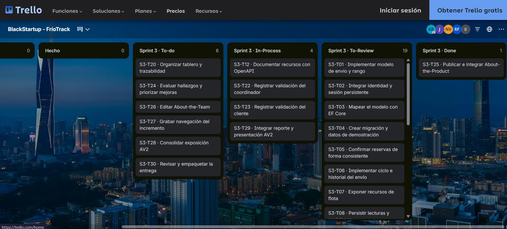

# Sprint Backlog 3

El objetivo del Sprint 3 fue permitir que el Coordinador Logístico programe y supervise envíos refrigerados y que el Cliente de Carga consulte los envíos que tiene asignados. El backlog reúne las tareas de integración entre la aplicación web, la API REST y PostgreSQL, así como las de despliegue, validación con usuarios y preparación de la entrega AV2.

**Tablero:** [BlackStartup – FríoTrack en Trello](https://trello.com/b/6qrvOukt/blackstartup-fr%C3%ADotrack).

*Tablero del Sprint 3 al 15 de noviembre de 2026. Fuente: Trello del equipo BlackStartup.*

La tabla vincula las historias con sus tareas y mantiene las estimaciones del [backlog base](sprint3-backlog-proposal.csv). Los estados corresponden a las listas de Trello al momento de la captura. La columna **Assigned To** identifica al integrante asociado con la evidencia disponible; la indicación **(propuesto)** distingue las asignaciones que no se registraron en Trello.

| Story Id | Story Title | Task Id | Task Title | Task Description | Estimation (Hours) | Assigned To | Status |
|---|---|---|---|---|---:|---|---|
| US33 / US08 | US33: Programación de envío refrigerado; US08: Configuración de umbrales térmicos | S3-T01 | Implementar modelo de envío y rango | Proteger invariantes ambientales y de programación con clases tipadas. | 8 | Alexander Sebastián Atauje Barreto | To-Review |
| US19 / US20 / US32 / TS05 | US19: Inicio de sesión en el sistema; US20: Cierre de sesión seguro; US32: Registro de Cliente de Carga; TS05: Endpoint de autenticación y sesión | S3-T02 | Integrar identidad y sesión persistente | Conservar autenticación segura y permisos de coordinador y cliente con persistencia. | 8 | Alexander Sebastián Atauje Barreto | To-Review |
| TS01 / TS03 | TS01: Endpoint de consulta de envíos activos; TS03: Endpoint de gestión de flotas | S3-T03 | Mapear el modelo con EF Core | Configurar entidades relaciones claves y tipos para PostgreSQL. | 8 | Alexander Sebastián Atauje Barreto | To-Review |
| TS01 / TS03 | TS01: Endpoint de consulta de envíos activos; TS03: Endpoint de gestión de flotas | S3-T04 | Crear migración y datos de demostración | Preparar migración inicial y semillas ficticias sin sobrescribir datos existentes. | 6 | Alexander Sebastián Atauje Barreto | To-Review |
| US33 / US17 | US33: Programación de envío refrigerado; US17: Asignación de conductor a vehículo | S3-T05 | Confirmar reservas de forma consistente | Evitar solapamiento de vehículo y conductor y cambios parciales al programar. | 8 | Alexander Sebastián Atauje Barreto | To-Review |
| US34 | US34: Gestión de estados del envío | S3-T06 | Implementar ciclo e historial del envío | Iniciar entregar o cancelar conforme al estado y conservar fecha y responsable. | 6 | Alexander Sebastián Atauje Barreto | To-Review |
| US14 / US15 / US16 / US18 / TS03 | US14: Registro de nueva unidad refrigerada; US15: Edición de datos de unidad; US16: Registro de conductores; US18: Configuración de dispositivos IoT; TS03: Endpoint de gestión de flotas | S3-T07 | Exponer recursos de flota | Implementar operaciones autorizadas de vehículos conductores y sensores independientes. | 8 | Alexander Sebastián Atauje Barreto | To-Review |
| US01 / US02 / US06 / TS04 | US01: Telemetría en vivo en el panel; US02: Mapa interactivo de rutas; US06: Detección de excursiones térmicas; TS04: Endpoint de recepción de telemetría IoT | S3-T08 | Persistir lecturas y posiciones | Persistir lecturas y ubicaciones de demostración. Validar rangos y fechas; esta tarea no incluye captura desde sensores físicos. | 8 | Alexander Sebastián Atauje Barreto | To-Review |
| US09 / US35 / TS02 | US09: Historial de alertas emitidas; US35: Registro de acción correctiva; TS02: Endpoint de consulta de alertas | S3-T09 | Implementar alertas y atención | Distinguir reconocimiento de resolución y conservar evidencia posterior normal en ambos intervalos. | 8 | — | To Do |
| US07 | US07: Notificaciones de incidencias en plataforma | S3-T10 | Registrar lectura de notificaciones | Permitir al destinatario autorizado marcar un aviso como leído explícitamente. | 4 | — | To Do |
| US10 / US11 / TS06 | US10: Consulta de historial térmico; US11: Exportación de informes de trazabilidad; TS06: Endpoint de exportación de reportes | S3-T11 | Exponer historial y evidencia de reporte | Consultar y exportar información autorizada con fechas unidades y procedencia. | 8 | — | To Do |
| TS07 | TS07: Documentación Swagger OpenAPI | S3-T12 | Documentar recursos con OpenAPI | Publicar especificación Swagger UI ejemplos y respuestas reales con seguridad. | 6 | — | To Do |
| TS01 / TS02 / TS03 / TS05 | TS01: Endpoint de consulta de envíos activos; TS02: Endpoint de consulta de alertas; TS03: Endpoint de gestión de flotas; TS05: Endpoint de autenticación y sesión | S3-T13 | Adaptar el gateway de la SPA | Consumir recursos REST manteniendo autorización errores y estados de carga. | 8 | — | To Do |
| — | — | S3-T14 | Probar invariantes del dominio C# | Cubrir reglas de rango estados reservas y recuperación sin dependencias de interfaz. | 8 | — | To Do |
| — | — | S3-T15 | Probar integración con PostgreSQL | Comprobar persistencia integridad transacciones y permisos sobre el motor real. | 8 | — | To Do |
| US30 / Soporte | US30: Gestión de multi-idioma (i18n) | S3-T16 | Revisar experiencia integrada ES y EN | Comprobar perfiles idiomas tamaños y errores de los recorridos seleccionados. | 6 | — | To Do |
| US26 / US30 | US26: Casos de éxito y testimonios; US30: Gestión de multi-idioma (i18n) | S3-T17 | Preparar landing y videos publicados | Corregir idioma por defecto y habilitar reproductores solo para enlaces válidos. | 6 | — | To Do |
| — | — | S3-T18 | Publicar API y base relacional | Aplicar migraciones y publicar servicio en recursos autorizados preservando datos. | 8 | — | To Do |
| US31 / Soporte | US31: Planes y acceso desde la Landing | S3-T19 | Publicar frontend y landing | Actualizar archivos públicos y verificar hashes y recorridos de entrada. | 4 | — | To Do |
| — | — | S3-T20 | Organizar tablero y trazabilidad | Relacionar historias tareas responsables revisores y versiones entre productos. | 4 | — | To Do |
| — | — | S3-T21 | Preparar sesiones de validación | Confirmar participantes tareas cuentas de prueba autorización y versión estable. | 4 | — | To Do |
| — | — | S3-T22 | Registrar validación del coordinador | Realizar las sesiones acordadas del segmento y conservar grabaciones y resultados. | 8 | — | To Do |
| — | — | S3-T23 | Registrar validación del cliente | Realizar las sesiones acordadas del segmento y conservar grabaciones y resultados. | 8 | — | To Do |
| — | — | S3-T24 | Evaluar hallazgos y priorizar mejoras | Aplicar formato heurístico registrar problemas reales y verificar las correcciones seleccionadas. | 8 | — | To Do |
| — | — | S3-T25 | Publicar e integrar About-the-Product | Consolidar demostración beneficios y opiniones auténticas de ambos segmentos. | 6 | — | To Do |
| — | — | S3-T26 | Editar About-the-Team | Consolidar sesiones reales retrospectiva y testimonio de cada integrante. | 6 | — | To Do |
| — | — | S3-T27 | Grabar navegación del incremento | Mostrar recorridos estables por perfil y los estados relevantes del Sprint 3. | 4 | — | To Do |
| — | — | S3-T28 | Consolidar exposición AV2 | Editar intervenciones de todos los integrantes con presentación y demostraciones. | 8 | — | To Do |
| — | — | S3-T29 | Integrar reporte y presentación AV2 | Actualizar secciones tablas diagramas capturas conclusiones y archivos de entrega. | 8 | — | To Do |
| — | — | S3-T30 | Revisar y empaquetar la entrega | Comprobar accesos enlaces nombres formatos y versiones y registrar aceptación. | 6 | — | To Do |
