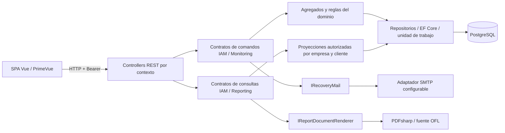
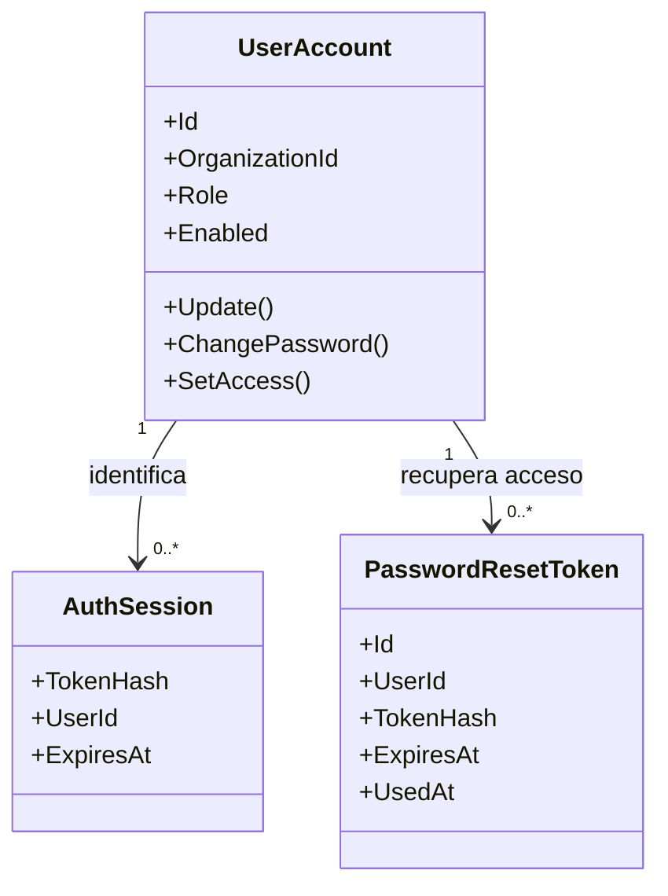

# Arquitectura y contratos del Sprint 4

El incremento mantiene los contenedores independientes de Landing Page, SPA, API ASP.NET Core y PostgreSQL. El adaptador HTTP de la SPA consume los recursos publicados por la API. El mapa interactivo utiliza OpenStreetMap bajo su atribución. Los datos de monitoreo siguen identificados como demostración.

## Conceptos aplicados

| Concepto de clase | Aplicación en FríoTrack |
| --- | --- |
| Bounded contexts | IAM agrupa acceso y recuperación; Monitoring recibe lecturas; Alert and Reporting consulta métricas, historial e informes. |
| Entidades, agregados y value objects | `UserAccount`, `Shipment`, `ShipmentMonitoring`, `Alert` y `ThermalRange` conservan estado, identidad e invariantes. |
| Separación por capas | Domain mantiene reglas; Application coordina casos de uso y define puertos; Infrastructure integra EF Core, SMTP y documentos; Interfaces expone recursos REST. |
| CQRS | `IAccountSecurityCommandService` e `IAccountAccessCommandService` separan modificaciones de `IAccountAccessQueryService` e `IOperationalQueryService` e `IShipmentQueryService`. |
| Controllers y recursos | Los controllers de cada contexto reciben recursos tipados, validan campos y devuelven los estados HTTP documentados. |
| Repository y unidad de trabajo | Los repositorios de agregados existentes y el `DbContext` coordinan persistencia; las operaciones de reserva y lotes confirman una transacción o la revierten. |
| Inyección de dependencias | Los controllers consumen contratos de aplicación; el composition root registra las implementaciones. |
| Integración externa mediante puertos | `IRecoveryMail` e `ICommercialContactMail` permiten configurar SMTP; `IReportDocumentRenderer` separa la representación del informe de su consulta autorizada. |
| EF Core y base relacional | Se conservan las 18 tablas y la migración del incremento anterior. Las nuevas funciones reutilizan `password_reset_tokens`, sesiones e historial. |
| Pruebas y control de versiones | Casos de dominio, integración con PostgreSQL, navegador, GitFlow, Conventional Commits y versiones semánticas. |

Las guías Learning Center Platform y Study Guide proporcionadas en clase se utilizan como referencia de estructura. Los servicios, roles, recursos y reglas corresponden al transporte refrigerado de FríoTrack.

## Identidad y permisos

El Coordinador Logístico administra los recursos y accesos de su empresa. El Cliente de Carga consulta solo envíos asignados. Un cambio de rol o habilitación revoca sesiones. No se admite que el coordinador se bloquee a sí mismo ni que un cliente con envíos asignados cambie a coordinador. Las sesiones son opacas y se conservan mediante hashes; la recuperación no devuelve el token al solicitante HTTP.

## Contratos incorporados

| Método | Recurso | Regla principal |
| --- | --- | --- |
| GET | `/api/analytics/monthly?month=YYYY-MM` | Proyección mensual de los envíos autorizados por su fecha de salida UTC. |
| GET | `/api/audit?month=YYYY-MM` | Historial sin duplicar acciones; admite usuario `actor` e intervalo UTC `[from,to)` de hasta 366 días. |
| GET | `/api/analytics/quarterly?year=2026&quarter=4` | Indicadores de todos los envíos autorizados con salida en ese trimestre. |
| GET | `/api/shipments` | Filtros combinables `q`, `status`, `vehicleId`, `active`, `from` y `to`. |
| DELETE | `/api/vehicles/{id}`, `/api/drivers/{id}`, `/api/sensors/{id}` | Baja lógica idempotente; preserva historial y rechaza reservas activas. |
| POST | `/api/commercial-contacts` | Solicitud validada al buzón fijo del equipo; requiere SMTP y se limita a 3/minuto/IP. |
| GET | `/api/reports/monthly/pdf?month=YYYY-MM` | Resumen ejecutivo con periodo, rutas, lecturas y procedencia. |
| GET | `/api/reports/{id}/pdf` | Copia persistida de trazabilidad; aplica los permisos del envío. |
| POST | `/api/shipments/{id}/readings/batch` | 1–100 lecturas ordenadas; validación y confirmación atómica. |
| GET | `/api/accounts` | Solo el coordinador de la empresa; excluye credenciales. |
| PUT | `/api/accounts/{id}/access` | Cambia rol/habilitación y revoca las sesiones del afectado. |
| POST | `/api/auth/forgot-password` | Solicitud genérica, sin revelar la existencia de la cuenta. |
| POST | `/api/auth/reset-password` | Token de un solo uso, 15 minutos y revocación de sesiones. |
| GET | `/api/capabilities` | Disponibilidad de funciones; no contiene secretos de configuración. |

La especificación completa se consulta en [Scalar](https://friotrack-api-bce6db1b.azurewebsites.net/scalar/v1). El proveedor de correo debe configurarse para activar el envío real. La bitácora es operativa y no representa logs de infraestructura; las métricas mensuales y trimestrales no representan certificación de una cadena de frío física. El trimestre agrega todas las lecturas registradas y evita promediar promedios mensuales redondeados. El reporte PDF ejecutivo corresponde explícitamente al mes elegido.
